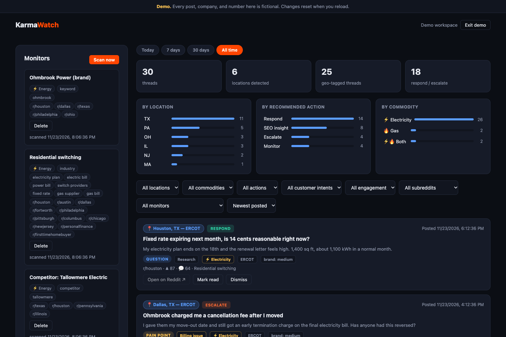
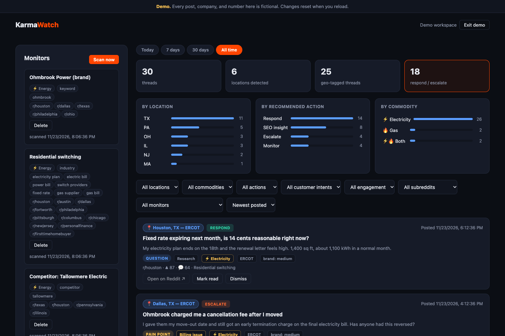

# Karma Watch

Karma Watch finds Reddit conversations a brand should know about, then sorts them by **where the customer is**, **what they need**, and **what to do next**.

> Reddit discovery should follow the customer's geography and lived problem, not just the company's product category.



This is a portfolio project built around a fictional energy retailer, "Ohmbrook Power". Every company and post in the demo is made up. It is not affiliated with Reddit, Inc.

## Try the demo

**[karma-watch-demo.netlify.app](https://karma-watch-demo.netlify.app/#/app)**, with no account needed.

To run it locally instead, you need Node 18 or newer. There is nothing to install.

```shell
npm run demo
```

Open http://localhost:4173. The demo runs the real dashboard code against an in-memory stand-in for the database, so filters, triage, and monitor editing all work. It makes no outside requests, and changes reset on reload.

Location, market, commodity, and keyword matches in the demo come from the real scanner code. Intent and recommended action are labelled by hand to stand in for the AI classifier.

## The problem

Keyword alerts treat every mention the same. An energy retailer can only serve some states, so a thread titled "Is 14 cents reasonable?" is worth a reply in Houston and irrelevant in a regulated market. Karma Watch makes location the first thing you see, then recommends one of four actions: respond, monitor, escalate, or use as an SEO insight.



## How it works

| Part | What it does |
|---|---|
| `index.html` | Landing page, sign-in, and dashboard in one static file |
| `supabase/functions/scan-reddit` | Cloud scanner: fetch, match, dedupe, classify |
| `scanner/` | The same pipeline as a local Node script with no dependencies |
| `supabase/migrations` | Tables, indexes, and row level security |
| `demo/` | Fictional posts and the in-memory database stand-in |

[ARCHITECTURE.md](ARCHITECTURE.md) explains the design and its trade-offs.

## Status

**Working**
- Dashboard: filters, drill-downs, period comparison, and triage
- Keyword matching, deduplication, and location and commodity tagging
- AI classification with a rule-based fallback when no AI key is set
- Owner-only data access, enforced in the database

**Not finished**
- Email alerts: matches are queued in `alert_log`, but this repo does not deliver them
- AI-drafted replies, billing, and plan limits
- Rate limiting on manual scans
- The local scanner tags fewer fields than the cloud scanner

## Data sources and limits

The scanners read public posts from two third-party archives, PullPush and Arctic Shift. They do not call Reddit's API. Archives can lag, miss posts, or go offline, and may keep posts their authors have deleted. Anyone using this with real data should review Reddit's current terms first. Commercial use would need an approved data source.

The tool finds conversations for a person to review. It never posts to Reddit.

## Run the checks

```shell
npm run verify
```

Runs static checks and unit tests, then builds `dist/`.

## Deploy your own

1. Create a Supabase project and apply `supabase/migrations/0001_init.sql`.
2. Set `SUPABASE_URL` and `SUPABASE_PUBLISHABLE_KEY` (see `.env.example`) in your host's build settings, then run `npm run build`. The build refuses any key that is not a publishable key. Without those values, it builds the demo only.
3. Publish `dist/` and nothing else.
4. For the cloud scanner, set `KARMA_WATCH_SECRET_KEY`, `CRON_SECRET`, and `ALLOWED_ORIGIN` as function secrets, plus `OPENAI_API_KEY` or `ANTHROPIC_API_KEY` if you want AI classification. The function does its own authorization, so deploy it with `--no-verify-jwt`.
5. Schedule a POST to the function every 15 minutes with the `x-cron-secret` header.

For the local scanner, see [scanner/README.md](scanner/README.md).
